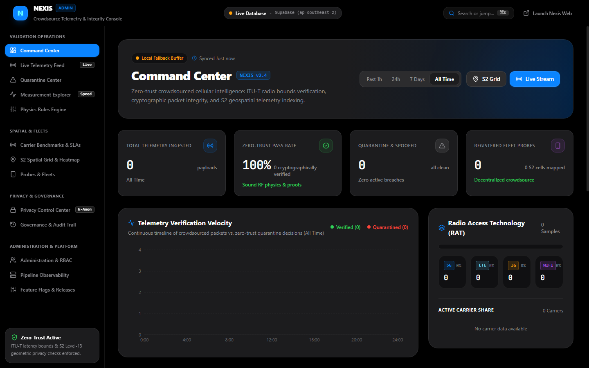
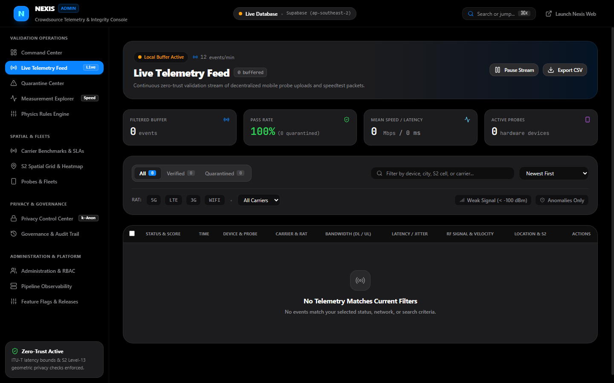
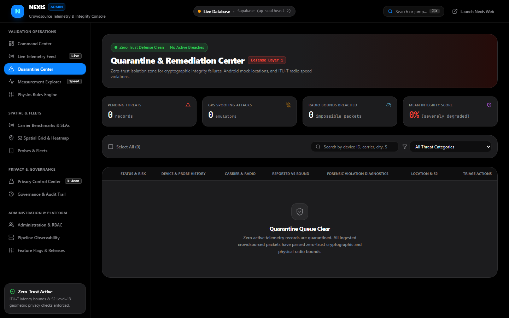
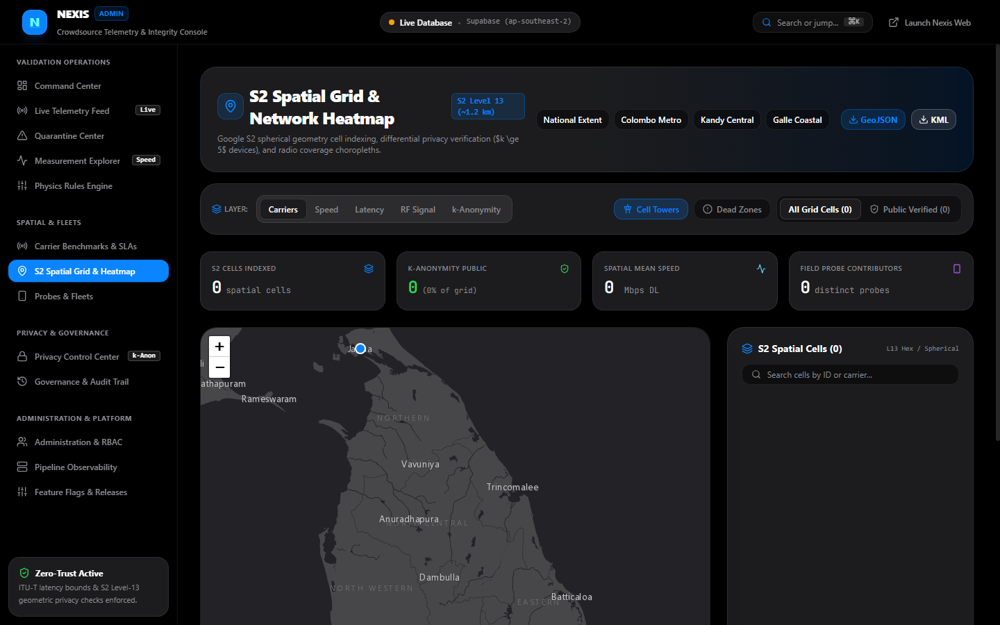
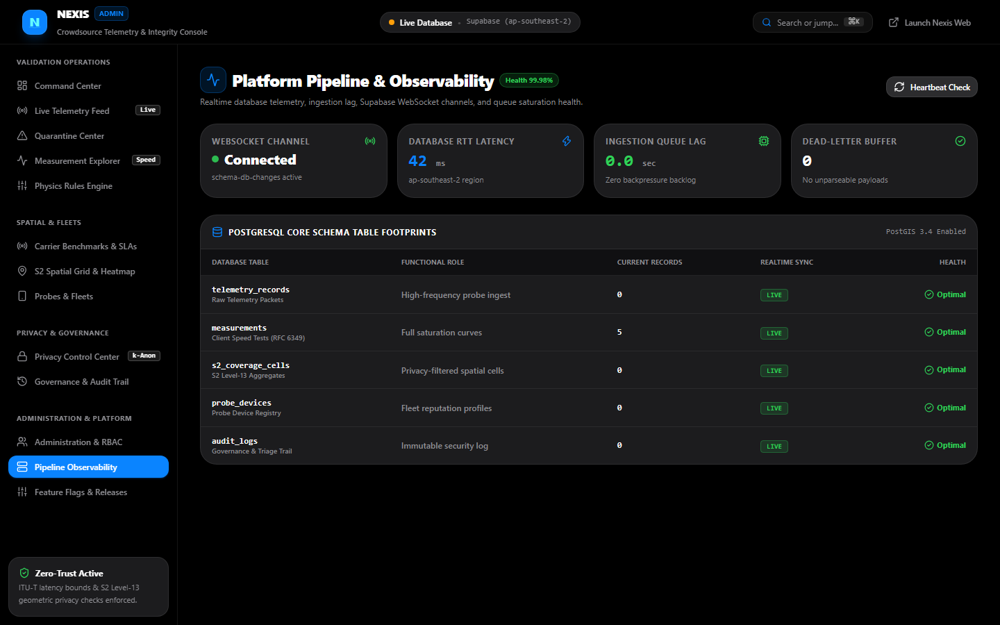
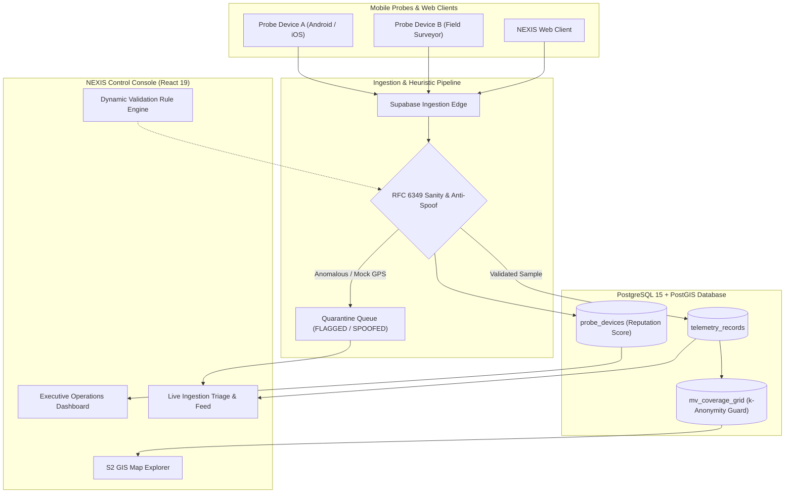

# NEXIS Control — Telemetry Validation & Integrity Console

<p align="center">
  <strong>Enterprise Control Plane for Crowdsourced Cellular Telemetry, PostGIS Geospatial Aggregation & Anti-Spoofing Verification</strong>
</p>

<p align="center">
  
</p>

<p align="center">
  
  
  
  
  
  
  
</p>

---

## 📸 Interface Showcase

### 1. Operations Dashboard
Real-time ingestion health, carrier market performance breakdown, probe fleet status, and telemetry verification rates.


### 2. Live Validation Feed & Triage
Continuous real-time ingestion pipeline streaming incoming mobile probes with immediate heuristic validation scoring.


### 3. Anti-Spoofing & Quarantine Engine
Automated anomaly detection isolating GPS teleports, Mock Location injections, impossible RF values, and synthetic throughput spikes.


### 4. S2 Spatial Grid & Coverage Materialization
Google S2 cell (Level 13) spatial aggregation with enforced $k$-anonymity ($\ge 2$ distinct probes) preventing individual user tracking.


### 5. Platform Observability & Telemetry Health
Database connection pool telemetry, queue depths, RPC bounding box latency, and live error budget tracking.


---

## 🏛️ System Architecture



---

## ✨ Key Features

| Capability | Description | Technical Implementation |
| :--- | :--- | :--- |
| **Real-time Ingestion Stream** | Sub-second streaming of incoming field probes | Supabase Realtime Channels / WebSockets |
| **Heuristic Anomaly Detection** | Flags GPS jumps ($> 900\text{ km/h}$), impossible speeds ($> 10\text{ Gbps}$), and low-confidence cells | Multi-variate sanity constraints & SQL triggers |
| **Spatial $k$-Anonymity** | Materializes coverage heatmaps only when $\ge 2$ verified distinct probes validate a cell | PostGIS S2 Level 13 Materialized Views (`mv_coverage_grid`) |
| **Probe Reputation Scoring** | Tracks contribution credibility (0–100) per probe identifier | Automated reputation decay & probation workflows |
| **Carrier Analytics** | Benchmarks Dialog Axiata, SLT-Mobitel, Airtel, Hutch, and fixed broadband providers | Statistical median percentile calculations ($P_{50}, P_{90}$) |
| **Granular Privacy Controls** | Enforces /24 (IPv4) and /64 (IPv6) subnet truncation and geofenced exclusion zones | GDPR, CCPA/CPRA, and Sri Lanka PDPA compliance |

---

## 🚀 Quick Start

### Prerequisites
* **Node.js**: v20.x or higher
* **Package Manager**: `pnpm` (recommended), `npm`, or `yarn`
* **PostgreSQL / Supabase**: PostgreSQL 15+ with PostGIS extension enabled

### 1. Installation

```bash
git clone https://github.com/SahanPramuditha-Dev/Nexis-Web-Admin.git
cd Nexis-Web-Admin
pnpm install
```

### 2. Configure Environment

Copy `.env.example` to `.env`:

```bash
cp .env.example .env
```

Set your Supabase credentials:

```ini
VITE_SUPABASE_URL=https://your-project.supabase.co
VITE_SUPABASE_ANON_KEY=your-anon-public-key
```

### 3. Database Schema Setup

Deploy the enterprise schema to your PostgreSQL / Supabase instance:

```bash
# Using Supabase CLI or psql:
psql -h your-db-host -U postgres -d postgres -f database/schema.sql
```

The schema automatically initializes:
* PostGIS spatial extensions
* Partitioned `telemetry_records` tables
* Spatial indexes (`GIST` on geometry and B-tree on S2 cells)
* `mv_coverage_grid` with $k$-anonymity filtering
* Viewport RPC query function: `get_coverage_in_bbox()`

### 4. Run Development Server

```bash
pnpm run dev
```

Open [http://localhost:5174](http://localhost:5174) in your browser.

---

## 🔒 Security & Privacy Posture

* **Zero Personal Identification:** Mobile probes submit ephemeral hash tokens (`probe-anon-xxxx`) that rotate periodically.
* **Geofence Suppression:** Automated triggers discard telemetry points originating within registered user residential coordinates.
* **Role-Based Access Control (RBAC):** Admin consoles are protected by Supabase Row-Level Security (RLS) policies.

---

## 📄 License

Distributed under the Apache 2.0 License. See `LICENSE` for details.
